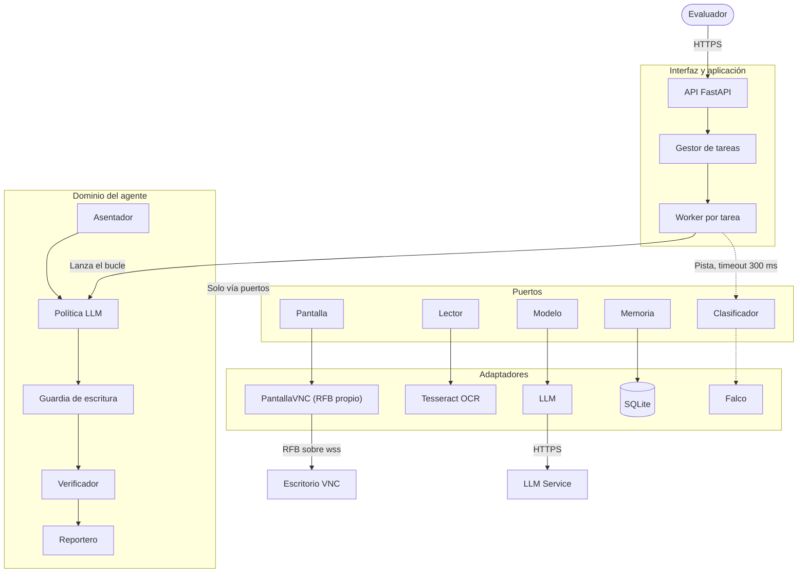

## Problema y objetivo

Construimos un agente que opera apps sin API solo por pantalla (VNC, 1280×800) y ejecuta tareas en lenguaje natural en apps que nunca vio. Se evalúa sobre una app desconocida, con 5 minutos por tarea.

- **Correcta** = cambios esperados, cero cambios de más, cero duplicados y `estado` final correcto.
- **Sin falsos éxitos**: reportar `terminada` en una tarea que no quedó bien cuenta como error.
- **Resumen**: línea `respuesta: <valor>` en preguntas, datos que expliquen el fallo en tareas imposibles y nunca secretos.
- **Restricción**: nada de agentes de terceros ni lectura del DOM; el bucle, la percepción y las acciones son nuestros.

## Diagrama de arquitectura

Monolito modular con puertos y adaptadores: el dominio solo habla con puertos, así que cambiar de sistema es cambiar un adaptador.

Cada acción pasa por la guardia antes de tocar la pantalla, y el dominio llega a VNC, OCR, LLM y SQLite solo a través de los puertos.

## Falco Swift: clasificador rápido

Falco Swift, clasifica la instrucción antes del bucle y le da pistas a la política.

| Pregunta | Tipo | Para qué sirve |
| --- | --- | --- |
| `tipo` | choice: crear, modificar, eliminar, exportar, pregunta | Elegir el prompt de fase y el modelo |
| `destructiva` | sí/no | Endurecer la guardia: confirmar alcance antes de cualquier commit |
| `dos_datos` | sí/no | Avisar al reportero que `respuesta:` lleva `A; B` |

## Flujo de una tarea

Cada tarea es una `asyncio.Task` dentro del mismo proceso; no hay Celery ni Redis porque el trabajo es casi todo espera de red.

1. `POST /tasks` crea el id y responde; si el escritorio tiene una tarea viva, se cancela.
2. El worker pide pistas a Falco (máximo 300 ms, en paralelo), conecta por VNC, lee la fecha que muestra la app ("hoy") y consulta la memoria.
3. La política planea y chequea precondiciones: duplicado, registro inexistente, dato inválido o tarea peligrosa terminan en `fallida` sin tocar nada.
4. Bucle: captura asentada, decisión del LLM, revisión de la guardia, acción.
5. Tras cada commit, el verificador confirma en pantalla; sin confirmación no hay `terminada`.
6. El reportero arma el resumen, el worker cierra el VNC y guarda el procedimiento si se verificó.

OCR y compresión de capturas van en `asyncio.to_thread` para no frenar la API. uvicorn corre con un solo proceso porque el registro de tareas vive en memoria (respaldado en SQLite).

## Stack y despliegue

Todo en Python 3.13 con `uv`, en un contenedor sobre una VM de 2 vCPU y 4 GB.

| Capa         | Elección                                                                                  |
| ------------ | ----------------------------------------------------------------------------------------- |
| API          | FastAPI + uvicorn + pydantic                                                              |
| VNC          | `websockets` + cliente RFB propio, `pycryptodome` para la auth DES                        |
| Imagen y OCR | numpy, Pillow, Tesseract 5 (spa) + pytesseract                                            |
| LLM          | LLM por Messages API con herramientas propias, sin la herramienta empaquetada de computer |
| Clasificador | Falco (`torch` + `transformers`, CPU)                                                     |
| Persistencia | SQLite: tareas y procedimientos; trazas PNG + JSONL por paso                              |
| Despliegue   | Docker Compose con `restart: always`, Caddy con TLS automático                            |
| Pruebas      | pytest + `dev_tools/run_tests.py` contra `/__reset` y `/__check`                          |

## Riesgos y decisiones

El mayor riesgo es el falso éxito; ante la duda, el agente reporta `fallida`.

| Riesgo | Mitigación |
| --- | --- |
| Captura vieja tras un clic | Asentador: espera cambio y 300 ms de quietud, tope de 2 s |
| Clic ignorado o texto concatenado | Clic de 150 ms; Ctrl+A antes de escribir y relectura del campo |
| Registro duplicado | Búsqueda previa y guardia: nunca repetir un commit sin verificar |
| Editar el registro equivocado | Coincidencia exacta del nombre; si hay ambigüedad, `fallida` con los candidatos |
| Cambios de más | Solo se tocan los campos que nombra la instrucción |
| Operar después de los 5 min | Reloj de 4:15, cancelación y cierre del socket |
| Número mal comparado | `respuesta:` primero, sin separador de miles; dos datos con `;` |
| Filtrar la contraseña | Filtro de secretos en el reportero; la contraseña nunca se persiste |
| App desconocida o que cambia | OCR en vez de coordenadas fijas; memoria como pista, no como script |
| Falco lento, caído o equivocado | Timeout de 300 ms, umbral de 0.8, interruptor de circuito; sus pistas solo suman cautela |

**Decisiones:** 
· monolito modular y no microservicios 
· la lógica mecánica va en código, no en prompts 
· captura a 1280×800 nativos para que las coordenadas sean exactas 
· Falco Swift da pistas y da una guía de respuesta.
